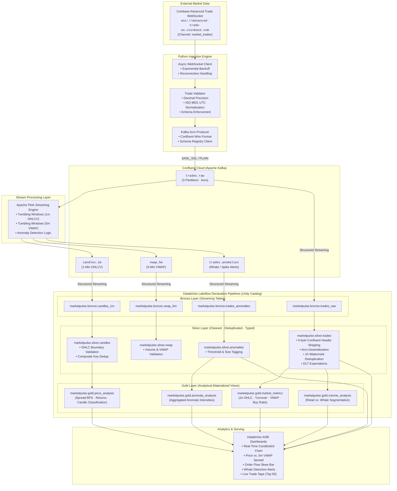

# MarketPulse Lite — Real-Time Crypto Data Engineering Platform

[](https://databricks.com)
[](https://spark.apache.org)
[](https://delta.io)
[](https://avro.apache.org)

An end-to-end, production-grade real-time market data streaming platform that ingests live cryptocurrency trades from the **Coinbase WebSocket feed**, serializes events using **Apache Avro** with **Confluent Schema Registry**, processes derived streams via **Apache Flink**, and orchestrates a full **Medallion Lakehouse Architecture** on **Databricks Lakeflow Declarative Pipelines (Delta Live Tables)** with **Unity Catalog** and **AI/BI Dashboards**.

---

## 1. System Architecture



---

## 2. Technology Stack & Rationale

| Layer | Technology | Engineering Rationale |
|---|---|---|
| **Data Source** | Coinbase Advanced Trade WebSocket | Direct tick-level public market execution stream (`BTC-USD`). |
| **Ingestion** | Python (`asyncio`, `websockets`) | Asynchronous, event-driven networking with exponential backoff and connection recovery. |
| **Data Integrity** | Python `decimal.Decimal` | Prevents floating-point rounding errors on financial prices and quantities before serializing. |
| **Serialization** | Apache Avro + Confluent Schema Registry | Strict contract enforcement, compact binary payloads, schema evolution with `FULL` compatibility. |
| **Message Broker** | Confluent Cloud (Apache Kafka) | Enterprise multi-partition streaming backbone with SASL_SSL / PLAIN encryption. |
| **Stream Compute** | Apache Flink | Event-time tumbling window aggregations (1m OHLCV, 5m VWAP) and streaming anomaly detection. |
| **Lakehouse Engine** | Databricks Lakeflow (Declarative Pipelines) | Serverless Spark Structured Streaming with automatic checkpointing, state management, and lineage graphs. |
| **Data Governance** | Unity Catalog | Three-tier namespace (`marketpulse.<layer>.<table_name>`) for catalog-wide ACLs and schema isolation. |
| **Storage Format** | Delta Lake | ACID transactions, time travel, schema enforcement, and streaming/batch unification. |
| **Analytics & BI** | Databricks SQL / AI/BI Dashboards | High-performance sub-second materialized view querying for candlestick charts and live market tapes. |
| **CI/CD & IaC** | Databricks Asset Bundles (DABs) | Declarative YAML-driven bundle deployments targeting `dev` and `prod` workspaces. |

---

## 3. Medallion Architecture Breakdown

### 🥉 Bronze Layer — Raw Event Ingestion
- **Engine:** Spark Structured Streaming (`spark.readStream.format("kafka")`).
- **Goal:** Ingest continuous micro-batches from Kafka topics while preserving exact raw bytes and metadata without transformation.
- **Tables:**
  - `marketpulse.bronze.trades_raw` (Source: `trades.raw`)
  - `marketpulse.bronze.candles_1m` (Source: `candles.1m`)
  - `marketpulse.bronze.vwap_5m` (Source: `vwap.5m`)
  - `marketpulse.bronze.trades_anomalies` (Source: `trades.anomalies`)
- **Metadata Columns Preserved:** `key`, `value`, `topic`, `partition`, `offset`, `timestamp`, `timestampType`, `ingested_at`.

---

### 🥈 Silver Layer — Cleaned, Validated & Deduplicated Streams
- **Engine:** Spark Structured Streaming (`spark.readStream.table("bronze.<table_name>")`).
- **Goal:** Unpack binary payloads, standardize data types, enforce data quality constraints, and perform stateful bounded deduplication.
- **Transformations:**
  1. **Confluent Wire Format Stripping:** Strips the leading 5-byte header (1 magic byte + 4-byte Schema ID) via `expr("substring(value, 6)")` before passing raw Avro bytes to `from_avro`.
  2. **Type Casting:** Prices to `DECIMAL(18, 8)` / `DECIMAL(20, 8)`, quantities to `DECIMAL(18, 8)` / `DECIMAL(20, 12)`, timestamps to UTC `TIMESTAMP`.
  3. **Data Quality Expectations (`@dp.expect_or_drop`):**
     - `positive_price`: `price > 0`
     - `positive_quantity`: `quantity > 0`
     - `valid_product_id`: `product_id IS NOT NULL AND length(trim(product_id)) > 0`
     - `valid_trade_time`: `trade_time IS NOT NULL`
     - `high_low_boundary` (Candles): `high_price >= low_price AND high_price >= open_price AND high_price >= close_price`
  4. **Stateful Event-Time Deduplication:**
     - Enforces `.withWatermark("trade_time", "1 hour")` / `.withWatermark("window_end", "1 hour")`.
     - Calls `.dropDuplicatesWithinWatermark(["trade_id"])` to guarantee exactly-once processing while preventing infinite memory growth in Spark state stores.
- **Tables:**
  - `marketpulse.silver.trades`
  - `marketpulse.silver.candles`
  - `marketpulse.silver.vwap`
  - `marketpulse.silver.anomalies`

---

### 🥇 Gold Layer — Analytical Materialized Views
- **Engine:** Lakeflow Materialized Views (`@dp.materialized_view`).
- **Goal:** Precomputed analytical views with automatic incremental refresh, optimized for BI dashboards.
- **Tables:**
  - `marketpulse.gold.market_metrics`: 1-hour tumbling window rollups computing OHLC prices via `min_by` / `max_by`, total volume, turnover, VWAP, buyer vs. seller volume, and the **Buy Ratio** order flow sentiment indicator.
  - `marketpulse.gold.price_analysis`: Spread analysis (`high - low`), basis points volatility (`spread_bps`), % return (`price_change_pct`), and candlestick categorization (`BULLISH`, `BEARISH`, `DOJI`).
  - `marketpulse.gold.volume_analysis`: Trade size segmentation into **Retail** (`< 0.1 BTC`), **Mid-tier** (`0.1–1.0 BTC`), and **Whale** (`≥ 1.0 BTC`), tracking institutional volume influence.
  - `marketpulse.gold.anomaly_analysis`: Anomaly frequency, total anomalous volume, peak trade value, and price boundaries.

---

## 4. Key Engineering Challenges & Solutions Solved

### 1. Serverless Shaded Kafka JAAS Classpath Conflict
- **Challenge:** On Databricks Serverless Compute, running Kafka SASL_SSL authentication using the standard `org.apache.kafka.common.security.plain.PlainLoginModule` throws `ClassNotFoundException` / `RESTRICTED_STREAMING_OPTION_PERMISSION_ENFORCED`.
- **Solution:** Serverless compute shades the Kafka client library. Configured the JAAS module using the required shaded namespace:
  ```python
  "kafka.sasl.jaas.config": "kafkashaded.org.apache.kafka.common.security.plain.PlainLoginModule required username='{}' password='{}';"
  ```

### 2. Deserializing Confluent Schema Registry Wire Format in Spark
- **Challenge:** Spark's native `from_avro()` requires standard Avro binary payloads. Confluent Schema Registry prepends a 5-byte header (`0x00` magic byte + 4-byte Schema ID integer). Passing the raw Kafka `value` to `from_avro()` crashes with magic byte parsing errors.
- **Solution:** Pre-filtered against empty/tombstone records (`length(value) > 5`) and stripped the header at the binary level using Spark SQL:
  ```python
  expr("substring(value, 6)")
  ```
  Combined with `options={"mode": "PERMISSIVE"}` to gracefully turn malformed records into null structs for quarantine via DLT expectations.

### 3. Multi-Schema Unity Catalog Medallion Routing
- **Challenge:** Default Lakeflow pipelines publish all tables into a single default target schema configured in the pipeline YAML.
- **Solution:** Leveraged Unity Catalog 2-level namespace resolution in table decorators (`@dp.table(name="bronze.trades_raw")`, `@dp.table(name="silver.trades")`, `@dp.materialized_view(name="gold.market_metrics")`), enabling a single declarative pipeline to dynamically route data across `marketpulse.bronze`, `marketpulse.silver`, and `marketpulse.gold`.

### 4. Streaming State Store Memory Explosion vs. Deduplication
- **Challenge:** At-least-once delivery from Kafka introduces duplicate trades during network retries. Using unbounded streaming deduplication (`dropDuplicates(["trade_id"])`) without watermarks forces Spark to remember every trade ID forever, resulting in inevitable Out-Of-Memory (OOM) crashes.
- **Solution:** Implemented event-time watermarking paired with bounded state deduplication:
  ```python
  df.withWatermark("trade_time", "1 hour").dropDuplicatesWithinWatermark(["trade_id"])
  ```
  This bounds state memory to 1 hour while guaranteeing exactly-once semantics for all operational retries.

---

## 5. Repository Structure

```text
marketpulse/
├── .env.example                                      # Environment template for Kafka credentials
├── .gitignore
├── requirements.txt                                  # Ingestion Python dependencies
├── README.md                                         # Project portfolio documentation
│
├── ingestion/                                        # Real-time WebSocket Ingestion Service
│   ├── websocket_client.py                           # Async WebSocket client with backoff
│   ├── event_parser.py                               # Normalizes Coinbase tick payloads
│   ├── validator.py                                  # Enforces business rules & Decimal precision
│   ├── producer.py                                   # Kafka Avro Producer with Schema Registry
│   └── consumer.py                                   # Local verification Kafka Avro consumer
│
├── schemas/                                          # Apache Avro Schemas (.avsc)
│   ├── trade.avsc                                    # Normalized trade event schema
│   ├── candles_1m.avsc                               # 1-minute OHLCV candle schema
│   ├── vwap_5m.avsc                                  # 5-minute VWAP metric schema
│   └── trades_anomalies.avsc                         # Trade anomaly detection schema
│
└── marketpulse_databricks/                           # Databricks Asset Bundle (DAB)
    ├── databricks.yml                                # DAB configuration (dev/prod targets)
    ├── pyproject.toml                                # Python project packaging
    │
    ├── resources/
    │   └── marketpulse_databricks_etl.pipeline.yml  # Declarative Pipeline definition
    │
    ├── dashboards/
    │   └── market_overview_queries.sql               # Production Databricks SQL queries
    │
    └── src/
        └── marketpulse_databricks_etl/
            └── transformations/
                ├── bronze/                           # Bronze Ingestion Streaming Tables
                │   ├── trades_raw.py                 # Kafka trades.raw -> bronze.trades_raw
                │   ├── candles_1m.py                 # Kafka candles.1m -> bronze.candles_1m
                │   ├── vwap_5m.py                    # Kafka vwap.5m -> bronze.vwap_5m
                │   └── trades_anomalies.py           # Kafka trades.anomalies -> bronze.trades_anomalies
                │
                ├── silver/                           # Silver Cleaned & Deduplicated Tables
                │   ├── trades.py                     # Unpack wire format, type, dedup trades
                │   ├── candles.py                    # OHLC boundary validation & typing
                │   ├── vwap.py                       # VWAP & volume consistency checks
                │   └── anomalies.py                  # Anomaly tagging & categorization
                │
                └── gold/                             # Gold Materialized Views (Analytics)
                    ├── market_metrics.py             # 1h OHLC, Volume, VWAP, Order Flow Skew
                    ├── price_analysis.py             # Volatility BPS, Returns, Candle Class
                    ├── volume_analysis.py            # Retail vs. Whale Flow Segmentation
                    └── anomaly_analysis.py           # Anomaly Frequency & Peak Intensities
```

---

## 6. Deployment & Quickstart

### Prerequisites
1. Python 3.12+
2. Databricks CLI (`v0.200+`) authenticated to your Databricks Workspace
3. Confluent Cloud account with a cluster and Schema Registry

### Step 1: Configure Ingestion Credentials
Create a `.env` file in the root directory:
```bash
BOOTSTRAP_SERVERS=pkc-xxxxx.us-east-2.aws.confluent.cloud:9092
KAFKA_API_KEY=YOUR_KAFKA_KEY
KAFKA_API_SECRET=YOUR_KAFKA_SECRET
SCHEMA_REGISTRY_URL=https://psrc-xxxxx.us-east-2.aws.confluent.cloud
SCHEMA_REGISTRY_API_KEY=YOUR_SR_KEY
SCHEMA_REGISTRY_API_SECRET=YOUR_SR_SECRET
```

### Step 2: Configure Databricks Secrets
Store credentials in the `marketpulse` secret scope in your Databricks workspace:
```bash
databricks secrets create-scope marketpulse
databricks secrets put-secret marketpulse bootstrap_servers --string-value "pkc-xxxxx.us-east-2.aws.confluent.cloud:9092"
databricks secrets put-secret marketpulse kafka_api_key --string-value "YOUR_KAFKA_KEY"
databricks secrets put-secret marketpulse kafka_api_secret --string-value "YOUR_KAFKA_SECRET"
```

### Step 3: Run Ingestion
```bash
pip install -r requirements.txt
python ingestion/websocket_client.py
```

### Step 4: Deploy and Run Databricks Lakeflow Pipeline
```bash
cd marketpulse_databricks

# Deploy the bundle to the development environment
databricks bundle deploy --target dev

# Trigger the Lakeflow Pipeline
databricks bundle run marketpulse_databricks_etl
```

---

## 7. Databricks AI/BI Dashboards

The Gold and Silver tables feed directly into **Databricks AI/BI Dashboards** to deliver real-time market intelligence:

1. **Executive KPI Cards:** Real-time BTC Price, Cumulative Volume, % Whale Flow, and Active Anomalies.
2. **1-Minute Candlestick Chart:** Interactive OHLC chart with Bullish/Bearish classification.
3. **Execution Price vs. 5m VWAP Spread:** Real-time benchmark comparison tracking institutional momentum.
4. **Order Flow Sentiment Bar:** Buyer vs. Seller initiated volume skew with a 50% neutral benchmark line.
5. **Retail vs. Whale Flow:** Stacked volume segmentation separating retail orders from whale blocks.
6. **Live Execution Tape:** Real-time stream of incoming trades with color-coded side indicators.

*(All dashboard queries are located in [marketpulse_databricks/dashboards/market_overview_queries.sql](file:///d:/projects/marketpulse/marketpulse_databricks/dashboards/market_overview_queries.sql)).*

---

## 8. License

Distributed under the Apache 2.0 License.

